# CareFlow HMS

**A multi-tenant Hospital Management System (SaaS)**, built on the MERN stack to serve many hospitals from one platform, with per-hospital data isolation enforced at the database layer.

**Live demo:** [hms-project-hhtz.vercel.app](https://hms-project-hhtz.vercel.app)

**Frontend**          

**Backend**          

**Tooling, tests and hosting**       

## Overview

CareFlow HMS runs a hospital's day-to-day operations in one system, from OPD registration and appointment scheduling to IPD admissions, lab diagnostics, pharmacy dispensing, billing and reporting, while the platform owner onboards and manages every hospital as an independent, fully isolated tenant. The repository holds two deployable projects, `hms-backend` (Express API) and `hms-frontend` (React SPA); nothing runs from the repository root, each folder installs and runs on its own.

## Features

**Platform and tenancy**
- Multi-tenant isolation at the database query layer, not hidden in the UI
- 9 roles (Platform Super Admin, Hospital Admin, Doctor, Receptionist, Nurse, Lab Technician, Pharmacist, Accountant, Patient), each with a tailored workspace
- Platform console for hospitals, subscriptions and demo leads, behind a public landing page

**OPD and the queue**
- Registration with auto-generated MRNs, doctor-wise scheduling, booking, cancellation and patient self check-in
- Live token queue: priority (`normal`/`senior`/`emergency`, with an audited reason), walk-in tokens, per-doctor-per-day sequences and a "Call next" that keeps one patient in consultation per doctor
- Waiting-room TV display: a login-free, revocable per-hospital link showing the token being served and the next five, with no names or MRNs

**Clinical care**
- Consultations with vitals, diagnosis and e-prescriptions, plus a patient EMR timeline including allergies and chronic conditions
- Wards and beds with live occupancy, admission/transfer/discharge and nursing rounds notes; lab test catalog and orders tracked through to results
- Pharmacy inventory at batch level with FEFO dispensing, low-stock alerts and atomic stock deduction
- Digital pre-check from the portal or the front desk (symptoms, vitals, reports), shown inside the consultation

**Billing, reports and audit**
- Itemized OPD/IPD/lab/pharmacy bills with payment tracking, insurance/panel/TPA splits and local payment methods (cash, card, JazzCash, EasyPaisa, bank transfer)
- Financial, clinical and operational report dashboards, plus JSON/CSV export of patients, bills, medicines and appointments with no lock-in
- Audit trail of every mutation and every patient-record read, with a readable action name, the record id and a user name/role snapshot; query strings are never stored

**Portal, settings and branding**
- Patient portal for bookings, self check-in, pre-checks, visit history and bills
- Hospital settings: the hospital's own name and logo, queue behaviour, senior age threshold, average consultation time and a regeneratable TV display key
- The logo reaches the app header, portal, TV board, printable slips and reminder emails, with initials as the fallback while CareFlow HMS stays the platform name
- Email notifications for low-stock, trial ending and appointment reminders, plus placeholder Terms/Privacy pages pending legal review

## Screenshots

_All screenshots show the seeded demo data created by `npm run seed:demo` (CareFlow Demo Hospital), so every queue number, patient and invoice below is reproducible._

<table>
  <tr><td align="center" width="33%">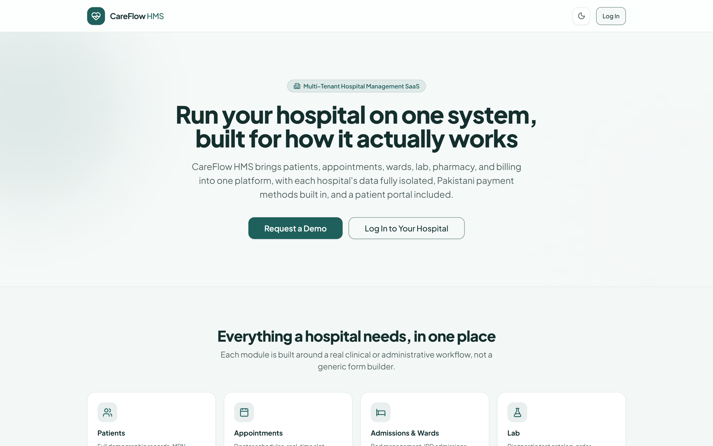<br /><b>Landing page</b></td><td align="center" width="33%">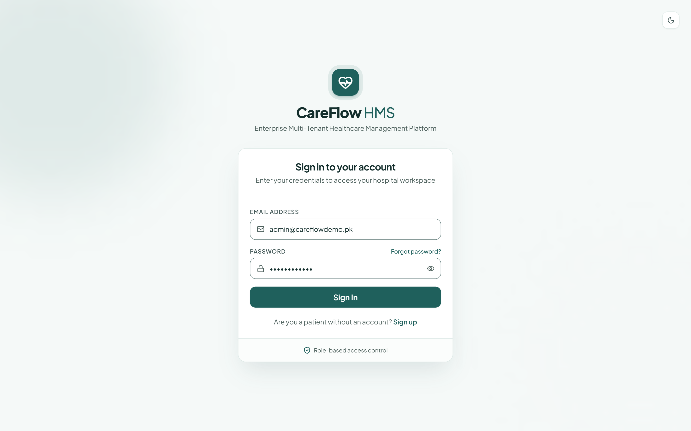<br /><b>Login</b></td><td align="center" width="34%">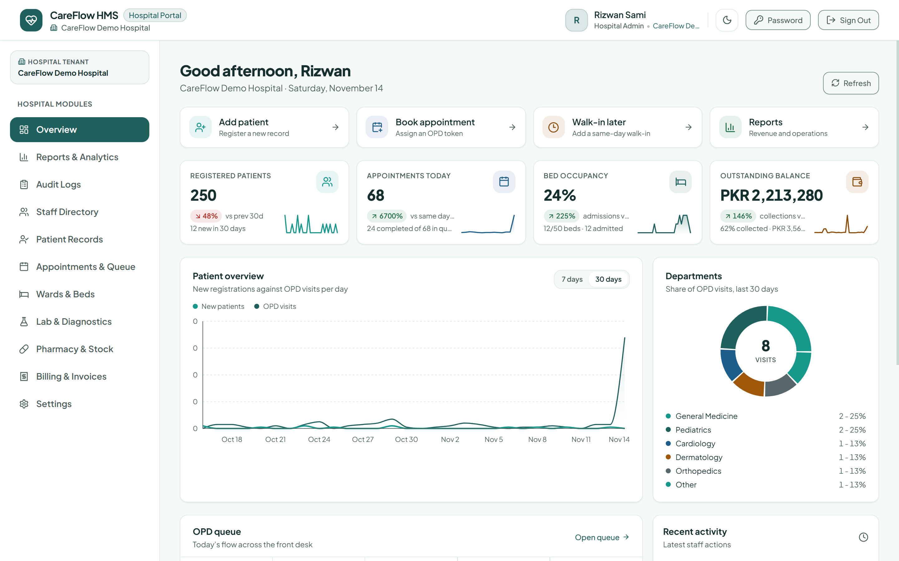<br /><b>Hospital admin dashboard</b></td></tr>
  <tr><td align="center" width="33%">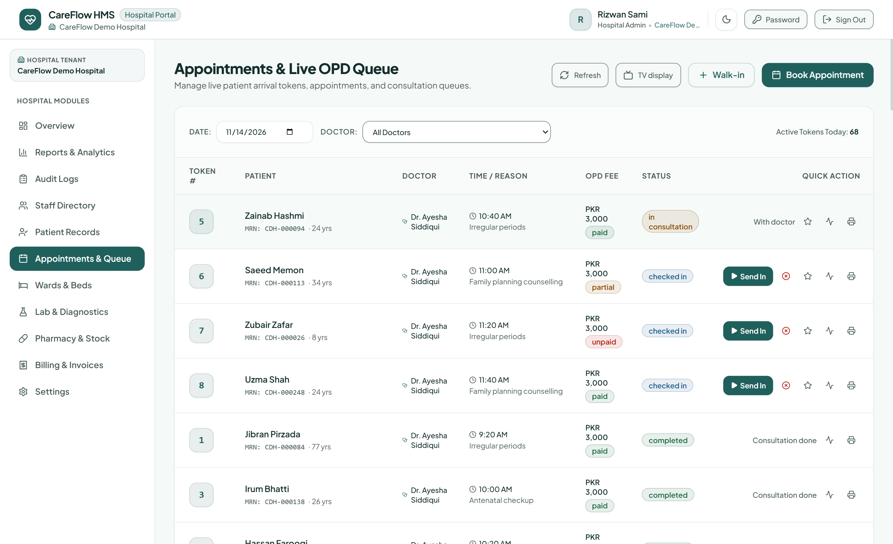<br /><b>Appointments queue</b></td><td align="center" width="33%">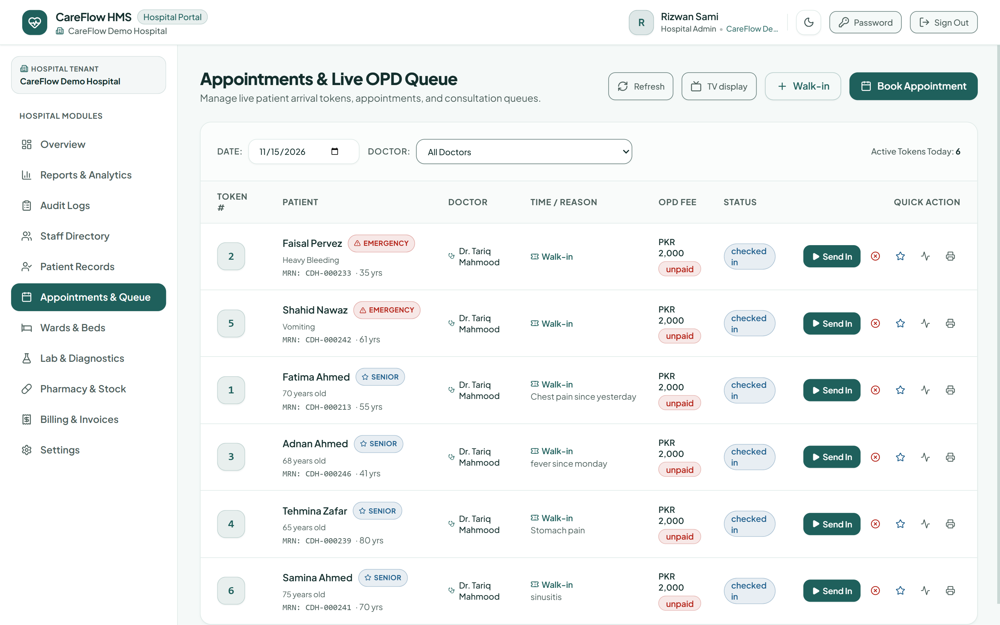<br /><b>Walk-in and priority</b></td><td align="center" width="34%">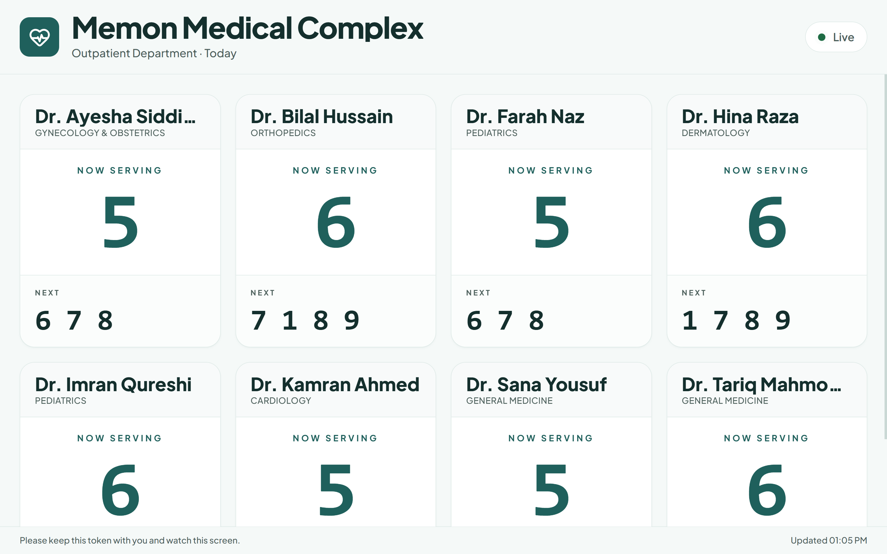<br /><b>Waiting-room TV display</b></td></tr>
  <tr><td align="center" width="33%">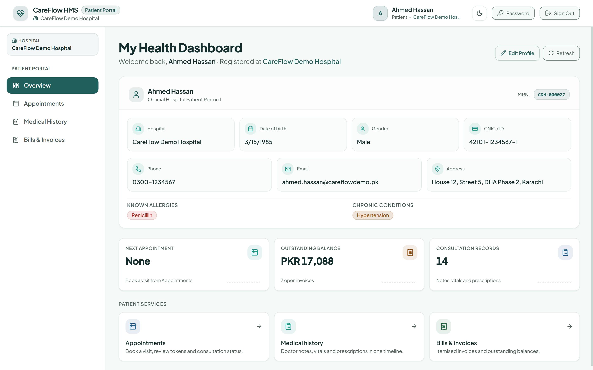<br /><b>Patient portal</b></td><td align="center" width="33%">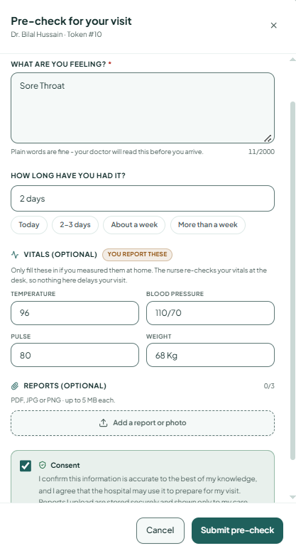<br /><b>Pre-check</b></td><td align="center" width="34%">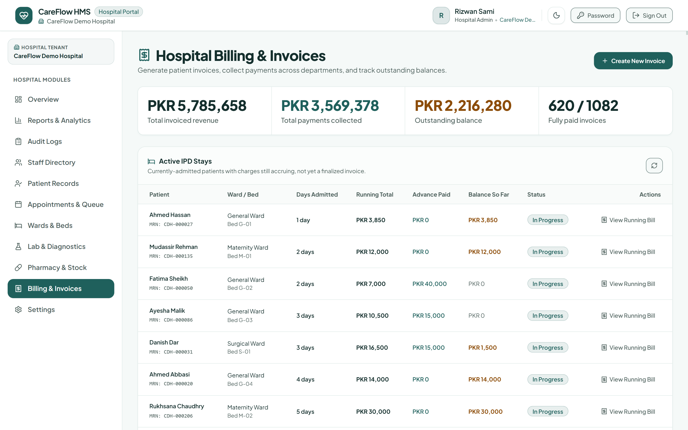<br /><b>Billing and invoices</b></td></tr>
  <tr><td align="center" width="33%">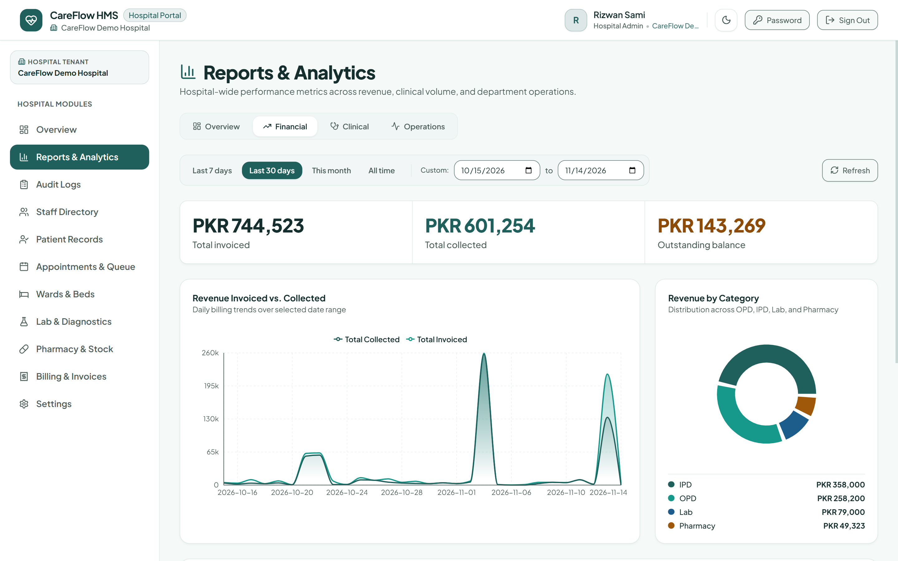<br /><b>Reports</b></td><td align="center" width="33%">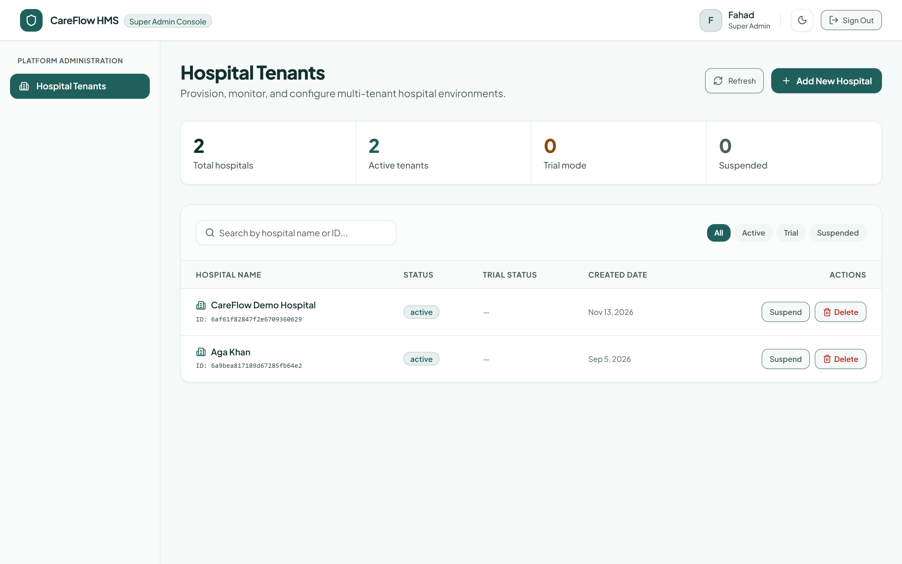<br /><b>Platform super admin</b></td><td align="center" width="34%">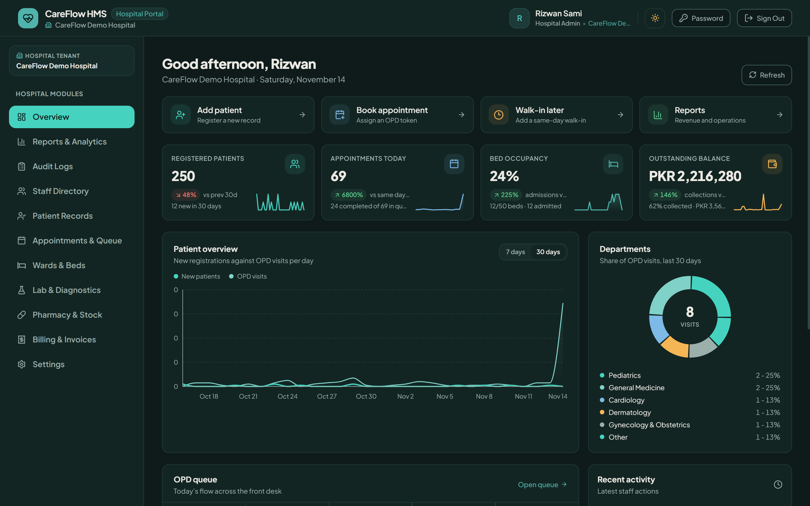<br /><b>Dark mode</b></td></tr>
  <tr><td align="center" width="33%">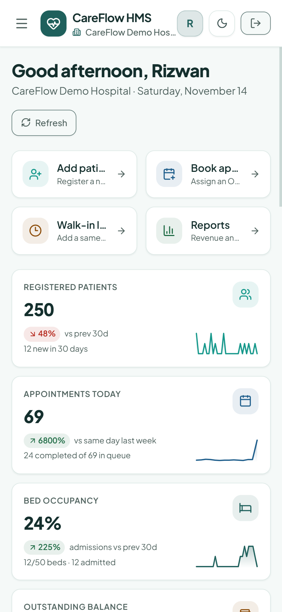<br /><b>Phone view (reception)</b></td><td align="center" width="33%">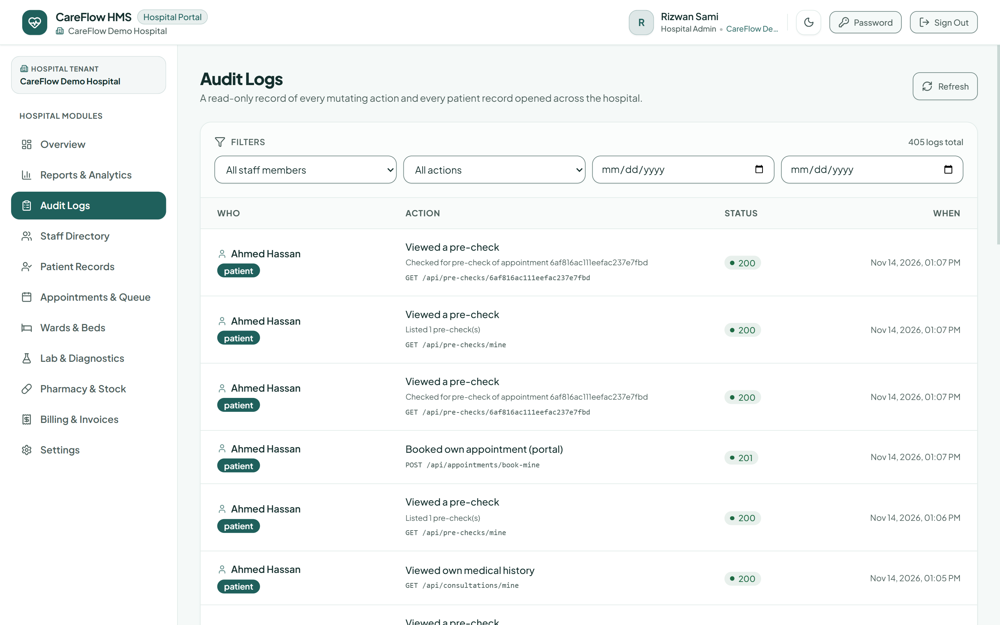<br /><b>Audit logs</b></td><td align="center" width="34%">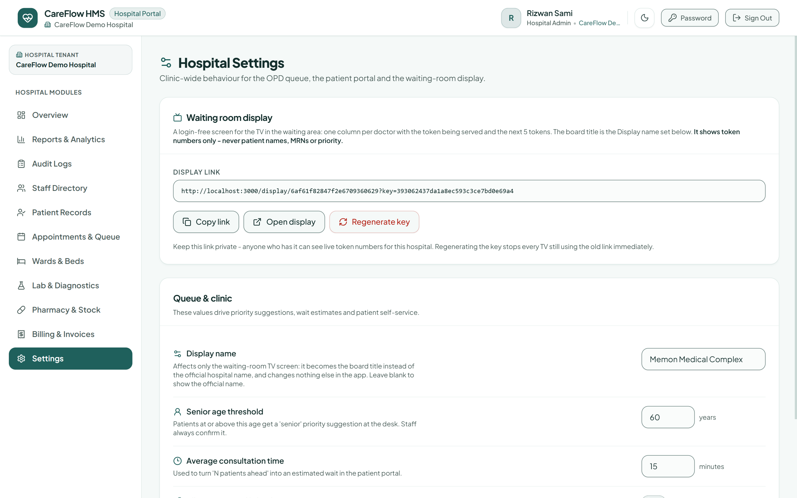<br /><b>Settings page</b></td></tr>
</table>

## Quick start

Node 20.19 or newer (Vite 8's minimum). Each side has its own `package.json`; run the two in separate terminals.

```bash
cd hms-backend
npm install
cp .env.example .env          # values from below; CLIENT_URL must list http://localhost:3000
npm run seed:superadmin       # creates the one Platform Super Admin account
npm run seed:demo             # optional: "CareFlow Demo Hospital" with 12 months of sample data
npm run dev                   # http://localhost:5000
```

```bash
cd hms-frontend
npm install
cp .env.example .env          # VITE_API_URL=http://localhost:5000 for local development
npm run dev                   # http://localhost:3000
```

## Environment variables

**Backend** (`hms-backend/.env`)

| Variable | Required | Used for |
| --- | --- | --- |
| `MONGO_URI` | Yes | MongoDB Atlas connection string (the free M0 tier is enough). |
| `JWT_SECRET` / `JWT_EXPIRES_IN` | Yes | The secret signs and verifies login tokens and must be at least 32 characters or the app refuses to start; the expiry sets the token lifetime, e.g. `1d`. |
| `CLIENT_URL` | Yes | Comma-separated allowed frontend origins for CORS, with no wildcard fallback. |
| `SUPER_ADMIN_NAME` / `_EMAIL` / `_PASSWORD` | once | Read only by `npm run seed:superadmin`, which creates the one Platform Super Admin. |
| `CLOUDINARY_CLOUD_NAME` / `_API_KEY` / `_API_SECRET` | Yes | Free-tier Cloudinary account used for every uploaded file. |
| `EMAIL_HOST` / `_PORT` / `_USER` / `_PASS` / `_FROM_NAME` | Yes | SMTP credentials and the "from" display name for outgoing email. |
| `LEAD_NOTIFICATION_EMAIL` | Yes | Inbox that receives "Request a Demo" submissions from the landing page. |
| `CRON_SECRET` | On Vercel | Bearer token Vercel sends to the cron endpoints; without it every job returns 401. |
| `APP_TIMEZONE` | No | IANA timezone for "today" and working-hours logic; defaults to `Asia/Karachi`. |
| `PORT` | Local only | Port for `npm run dev` / `node server.js`; unused on Vercel, which has no listening port. |

**Frontend** (`hms-frontend/.env`) sets one variable, `VITE_API_URL`: the base URL of the backend API, e.g. `http://localhost:5000` locally or the deployed backend URL in production.

Only `VITE_`-prefixed variables reach the browser, so nothing secret belongs in this file. A new backend variable is added here and to `hms-backend/.env.example` together.

## Scripts

**Backend** (`cd hms-backend`)

- `npm run dev` — starts the API with nodemon on `http://localhost:5000`.
- `npm start` — starts the API with plain `node server.js`.
- `npm test` — runs the backend suite on Node's built-in test runner.
- `npm run seed:superadmin` — creates the single Platform Super Admin from the `SUPER_ADMIN_*` variables.
- `npm run seed:demo` — builds or rebuilds the demo tenant (`-- --dry-run` to validate without writing, `-- --force` to allow it when `NODE_ENV=production`).
- `npm run sync:indexes` — brings every collection's indexes in line with the schemas, needed after an index definition changes.
- `npm run migrate:branding` — unsets the old TV-only display name and copies it into the hospital name where that name is empty.
- `npm run check:auth` — repeatable auth regression checks over HTTP (forgot password, login lockout, client countdown data).

**Frontend** (`cd hms-frontend`)

- `npm run dev` — starts the Vite dev server on `http://localhost:3000`.
- `npm run build` — production build into `dist/`.
- `npm run preview` — serves the production build locally.
- `npm run lint` — runs oxlint over `src/`.
- `npm run check:contrast` — audits every theme colour pair against WCAG 2.1 (4.5:1 text, 3:1 UI).
- `npm run check:focus` — static check for modal focus-trapping and form focus regressions.

## Architecture

Every Mongoose query is scoped to the signed-in user's hospital by an `AsyncLocalStorage` request context plus a Mongoose tenant plugin, so isolation is a property of the data layer rather than something each controller has to remember; aggregations must start with a `$match` on the current `hospitalId`, and `.setOptions({ skipTenantScope: true })` is the only deliberate bypass in the codebase. The queue engine increments one token counter per doctor per day atomically, keeps double-booking and "one patient in consultation per doctor" honest with partial unique indexes, and resolves waiting order in a single module (priority, then check-in time, then token) that the queue, "Call next", the portal and the TV display all share. On Vercel, `api/index.js` wraps the Express app for serverless use and the cron endpoints are protected by `CRON_SECRET`.

## Tests

`cd hms-backend && npm test` runs **140 tests across 8 files** on Node's built-in test runner (`node --test "tests/*.test.js"`). It boots an in-memory MongoDB through `mongodb-memory-server` and drives the real Express app with `supertest`, so it needs no Atlas connection, no credentials and no network. The suites cover tenant isolation, the role-by-route matrix, hospital access, patient signup, the appointment and queue flow, the audit trail, the demo seeder and hospital branding.

## Security notes

- Tenant isolation is enforced in the data layer; the one deliberate bypass is `.setOptions({ skipTenantScope: true })`, which can be found by grep.
- Passwords are bcrypt hashed, tokens are expiring JWTs, repeated failures trigger a temporary lockout, and a wrong password, a locked account and a missing account all return the same login response.
- `helmet` keeps nosniff, HSTS, no-referrer and frameguard, and CORS is an explicit allow-list with no wildcard fallback.
- Uploads are checked by file signature rather than the declared MIME type before they reach Cloudinary, and in production the error handler hides internal error text on 5xx responses.
- The waiting-room TV is the only login-free data endpoint: a 128-bit key compared in constant time, token numbers only, a per-IP rate limit, and regeneration invalidates every old link.
- Audit entries are written on the response, so a failed action is recorded as failed, and the stored path never includes the query string.
- The single root `.gitignore` keeps every `.env` out of the repository while keeping `.env.example` tracked.

## Deployment

1. Import the repository twice in Vercel, with Root Directory `hms-backend` for one project and `hms-frontend` for the other.
2. Set every backend variable, `CRON_SECRET` included, in the backend project; its `vercel.json` routes all traffic through `api/index.js` and schedules the cron jobs.
3. Set `VITE_API_URL` in the frontend project, pointing at the deployed backend; its `vercel.json` rewrites all routes to `index.html`.
4. Deploy both, with `CLIENT_URL` listing the deployed frontend origin.
5. Run `npm run sync:indexes` against production once whenever an index definition changes.

## License

Proprietary, all rights reserved.
