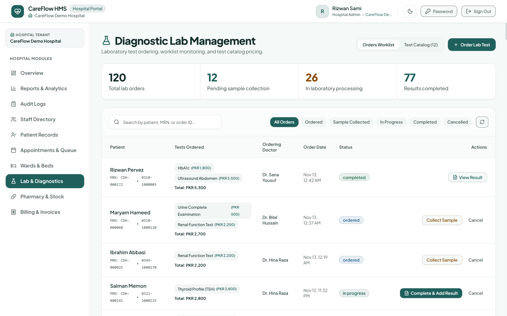

# CareFlow HMS

**A multi-tenant Hospital Management System (SaaS)**: built on the MERN stack to onboard and serve multiple hospitals from a single platform, with strict per-hospital data isolation enforced at the database layer.

**Frontend**


**Backend**


**Tooling**


**Runtime and hosting**


**Live demo:** [hms-project-hhtz.vercel.app](https://hms-project-hhtz.vercel.app)

## Overview

CareFlow HMS is designed for hospitals of any size to manage their day-to-day clinical and administrative operations, from OPD registration and appointment scheduling to IPD admissions, lab diagnostics, pharmacy dispensing, billing, and reporting, all within one system, while allowing the platform owner to onboard and manage 100+ hospitals as independent, fully isolated tenants. A public landing page handles demo requests from prospective hospitals, and each hospital's data (and payments) stay fully isolated from every other tenant.

## Features

- **Multi-Tenant Architecture:** each hospital's data (patients, staff, appointments, records) is completely isolated at the database query layer, not just hidden in the UI
- **Role-Based Access Control:** 9 distinct roles (Platform Super Admin, Hospital Admin, Doctor, Receptionist, Nurse, Lab Technician, Pharmacist, Accountant, Patient), each with a tailored workspace
- **Public Landing Page & Demo Requests:** a marketing front door where prospective hospitals can request a demo
- **OPD & Appointments:** patient registration with auto-generated MRNs, doctor-wise scheduling, a live token-based queue, patient self check-in from the portal, double-booking prevention enforced at the database level, and automatic no-show detection that frees the slot for rebooking
- **Clinical Records:** doctor consultations with vitals, diagnosis, and e-prescriptions; a full patient EMR timeline, including allergies and chronic conditions
- **IPD / Ward Management:** ward and bed setup, live occupancy tracking, admission/discharge workflow, nursing rounds notes
- **Laboratory:** test catalog, order tracking through to results
- **Pharmacy:** batch-level inventory tracking with FEFO (first-expiry-first-out) dispensing, low-stock alerts, and atomic stock deduction
- **Billing & Invoicing:** itemized bills across OPD/IPD/Lab/Pharmacy with payment tracking, insurance/panel/TPA coverage splits, and Pakistan-friendly payment methods (cash, card, JazzCash, EasyPaisa, bank transfer)
- **Reports & Analytics:** financial, clinical, and operational dashboards with charts
- **Data Export:** hospital admins can export their own patients, bills, medicines, or appointments as JSON or CSV at any time, with no lock-in
- **Audit Logging:** a complete record of every action taken across the system
- **Email Notifications:** low-stock, subscription-trial, and appointment reminder alerts
- **Patient Self-Service Portal:** patients can sign up, book their own appointments, check themselves in, and view their medical history and bills

## Screenshots

_All screenshots use the seeded demo data created by `npm run seed:demo`._

<table>
  <tr>
    <td align="center" width="33%"><b>Landing page</b></td>
    <td align="center" width="33%"><b>Hospital admin dashboard</b></td>
    <td align="center" width="34%"><b>Patient portal</b></td>
  </tr>
  <tr>
    <td align="center"></td>
    <td align="center"></td>
    <td align="center"></td>
  </tr>
  <tr>
    <td align="center"><b>OPD queue</b></td>
    <td align="center"><b>Lab and diagnostics</b></td>
    <td align="center"><b>Billing and invoices</b></td>
  </tr>
  <tr>
    <td align="center"></td>
    <td align="center"></td>
    <td align="center"></td>
  </tr>
</table>

## Architecture Highlights

- Tenant isolation is enforced automatically at the database layer using an AsyncLocalStorage-based request context combined with a Mongoose plugin, so every Mongoose query is scoped to the logged-in user's hospital by construction, not something a developer has to remember to add per-query. Aggregations are the one exception (a pipeline can't be filtered after the fact), so the plugin rejects any aggregate that doesn't start with a `$match` on the current `hospitalId`; deliberate cross-tenant work must opt out explicitly with `skipTenantScope` (grep for it to audit every such place).
- JWT-based authentication (1-day tokens, no refresh tokens) with the account, hospital status and trial state re-checked on every authenticated request, so suspending a hospital or disabling a staff member takes effect almost immediately.
- A hybrid patient-account model: hospital staff can enable portal access for an existing patient record, or a patient can self-register. A self-registration that matches an existing clinical record is never linked automatically, the record's own email must confirm a one-time code first (or front desk links it after checking ID in person).

## Getting Started

Each side has its own `package.json`; run the backend and frontend in separate terminals.

### 1. Backend

```bash
cd hms-backend
npm install
cp .env.example .env              # fill in every value from the environment table below
npm run seed:superadmin           # creates the one Platform Super Admin account
npm run seed:demo                 # optional: "CareFlow Demo Hospital" with 12 months of sample data
npm run dev                       # http://localhost:5000
```

### 2. Frontend

```bash
cd hms-frontend
npm install
cp .env.example .env              # VITE_API_URL=http://localhost:5000 for local development
npm run dev                       # http://localhost:5173
```

## Environment Variables

### Backend (`hms-backend/.env`)

All of these are read via `process.env` somewhere in `src/`. Set every one of them (except where noted "Vercel only" or "local only") in Vercel's dashboard under Project Settings, Environment Variables before deploying.

| Variable | Required | Used for |
| --- | --- | --- |
| `MONGO_URI` | Yes | MongoDB Atlas connection string (free M0 tier is enough). |
| `JWT_SECRET` | Yes | Signs and verifies login tokens. Must be at least 32 characters, or the app refuses to start. |
| `JWT_EXPIRES_IN` | Yes | Token lifetime, e.g. `1d`. |
| `CLIENT_URL` | Yes | Comma-separated list of allowed frontend origins for CORS (e.g. your Vercel frontend URL, plus `http://localhost:5173` for local dev). Required: there is no `*` fallback, and the app refuses to start without it. |
| `SUPER_ADMIN_NAME` | Yes (once) | Used only by `npm run seed:superadmin` to create the one Platform Super Admin account. |
| `SUPER_ADMIN_EMAIL` | Yes (once) | Same as above. |
| `SUPER_ADMIN_PASSWORD` | Yes (once) | Same as above. |
| `CLOUDINARY_CLOUD_NAME` | Yes | Free-tier Cloudinary account, used for any uploaded files/images. |
| `CLOUDINARY_API_KEY` | Yes | Same Cloudinary account. |
| `CLOUDINARY_API_SECRET` | Yes | Same Cloudinary account. |
| `EMAIL_HOST` | Yes | SMTP host for `src/utils/mailer.js` (e.g. Gmail SMTP). |
| `EMAIL_PORT` | Yes | SMTP port (e.g. `587`). |
| `EMAIL_USER` | Yes | SMTP username/login email. |
| `EMAIL_PASS` | Yes | SMTP password or app password. |
| `EMAIL_FROM_NAME` | Yes | Display name used as the "from" on outgoing emails. |
| `LEAD_NOTIFICATION_EMAIL` | Yes | Where "Request a Demo" submissions from the public landing page get emailed. Can be any inbox you check, e.g. your own. |
| `CRON_SECRET` | Yes (on Vercel) | Vercel automatically sends this as a Bearer token to the two cron endpoints. Without it set, both cron jobs are permanently rejected as unauthorized. Not needed locally since cron doesn't run on `npm run dev`. |
| `APP_TIMEZONE` | No | IANA timezone for "today"/working-hours logic, e.g. `Asia/Karachi`. Defaults to `Asia/Karachi` if unset. |
| `PORT` | Local only | Port for `npm run dev` / `node server.js`. Not used on Vercel (serverless, no listening port). |
| `NODE_ENV` | No | Set automatically by Vercel to `production`. |

### Frontend (`hms-frontend/.env`)

| Variable | Required | Used for |
| --- | --- | --- |
| `VITE_API_URL` | Yes | Base URL of the hms-backend API (e.g. `http://localhost:5000` locally, your deployed backend's URL in production). Read in `src/lib/api.js`. |

Vite only exposes env vars prefixed `VITE_` to client code (`import.meta.env.VITE_*`), so anything else added to `.env` here is silently invisible to the app. New backend variables must be added to this table and to `hms-backend/.env.example` in the same commit, so the two don't drift apart.

## Scripts

### Backend

| Command | What it does |
| --- | --- |
| `npm run dev` | Starts the API with nodemon on `http://localhost:5000`. |
| `npm start` | Starts the API with plain `node server.js`. |
| `npm run seed:superadmin` | Creates the single Platform Super Admin account from the `SUPER_ADMIN_*` variables. |
| `npm run seed:demo` | Builds or rebuilds the isolated "CareFlow Demo Hospital" tenant. `-- --dry-run` builds the dataset in memory and prints counts without writing; `-- --force` allows the run when `NODE_ENV=production`. |
| `npm run sync:indexes` | Brings every collection's indexes in line with the schemas. Needed after an index definition changes, since Mongoose won't replace an existing index with the same keys on its own. |
| `npm run check:auth` | Repeatable auth regression checks (forgot-password delivery path, login lockout, client countdown data). It creates two throwaway Platform Super Admin users over HTTP against the configured database, then deletes them; email credentials are cleared in-process so nothing is sent. |

### Frontend

| Command | What it does |
| --- | --- |
| `npm run dev` | Starts the Vite dev server on `http://localhost:5173`. |
| `npm run build` | Production build into `dist/`. |
| `npm run preview` | Serves the production build locally. |
| `npm run lint` | Runs oxlint over the source. |
| `npm run check:contrast` | Audits every theme colour pair in `src/index.css` against WCAG 2.1 (4.5:1 text, 3:1 UI). |

## Demo Data

`npm run seed:demo` builds one standalone tenant, **CareFlow Demo Hospital**, with 12 months of activity for screenshots and sales demos: staff and doctor schedules, 250 patients, ~900 appointments (including today's live OPD queue and the consultations behind it), wards and beds with current and past admissions, bills with paid/partial/unpaid balances, lab orders, pharmacy stock and dispensing, and the audit trail behind the dashboard's recent-activity feed.

Every write is scoped to that hospital's own `hospitalId`. It is idempotent: re-running it wipes and rebuilds only the demo hospital's data. Every date is generated relative to "now", so the data always looks current whenever it is run. At the end it prints the counts it created (plus billed/collected/outstanding totals and today's queue) and a login for every role. All demo accounts use the password `CareFlow@123`:

| Role | Email |
| --- | --- |
| Hospital admin | `admin@careflowdemo.pk` |
| Doctor | `kamran.ahmed@careflowdemo.pk` |
| Receptionist | `sadia.imtiaz@careflowdemo.pk` |
| Nurse | `rabia.aslam@careflowdemo.pk` |
| Lab technician | `farhan.ali@careflowdemo.pk` |
| Pharmacist | `mariam.zafar@careflowdemo.pk` |
| Patient portal | `ahmed.hassan@careflowdemo.pk`, `fatima.sheikh@careflowdemo.pk`, `ayesha.malik@careflowdemo.pk` |

The other doctors and staff accounts follow the same `firstname.lastname@careflowdemo.pk` pattern and are printed at the end of the run.

## Security Notes

- The demo seeder is tenant-safe: every write is scoped to the demo hospital's own `hospitalId`, no other hospital is read or modified, and the script aborts rather than reusing an email that already belongs to another tenant.
- In production (`NODE_ENV=production`, set automatically by Vercel) the global error handler hides internal `err.message` text on 5xx responses.
- Real credentials stay out of the repository: `.env` is git-ignored and `.env.example` lists every variable with safe placeholders.

## Deploying to Vercel

Both projects deploy from the same repository as two separate Vercel projects.

### Backend

1. Import the repo into Vercel and set Root Directory to `hms-backend`.
2. Add every backend variable from the table above in the Vercel dashboard (Project Settings, Environment Variables).
3. Deploy. `vercel.json` already routes everything through `api/index.js`, bundles the PDFKit font files, and defines the two daily cron jobs (trial check and appointment reminders) protected by `CRON_SECRET`.

### Frontend

1. Import the repo into Vercel and set Root Directory to `hms-frontend` (framework preset: Vite).
2. Add `VITE_API_URL` in the Vercel dashboard, pointing at your deployed `hms-backend` URL.
3. Deploy. `vercel.json` rewrites all routes to `index.html` for client-side routing.

### Hobby Plan Notes

- **Cron jobs:** capped at once a day each (not a job-count limit); both jobs here are daily. Anything needing finer timing is done as a lazy check on read instead of an extra cron job.
- **Function duration:** capped at 300 seconds; nothing here runs anywhere close to that.
- **Response size:** capped at 4.5 MB; the data export endpoint caps record counts per request and flags truncation so it stays under that. The frontend is a static Vite build with no serverless functions, so these limits don't apply to it.

## License

Proprietary, all rights reserved.
