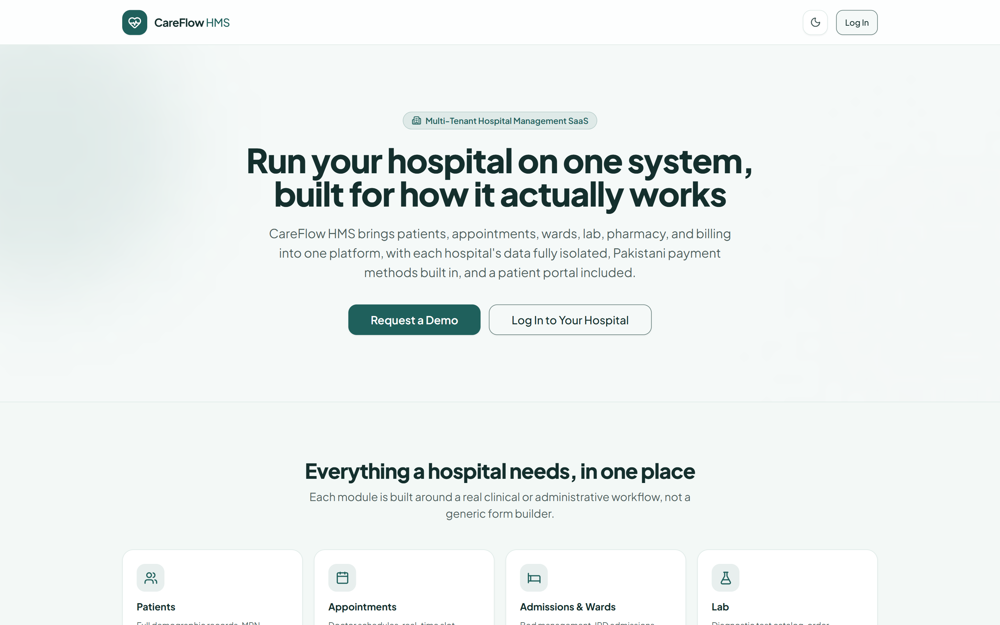
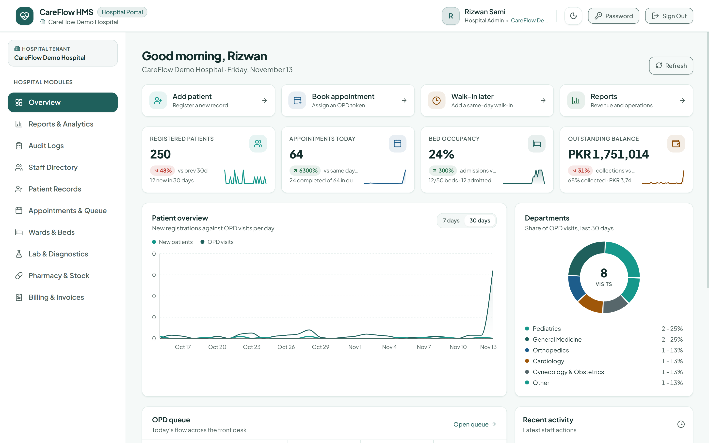
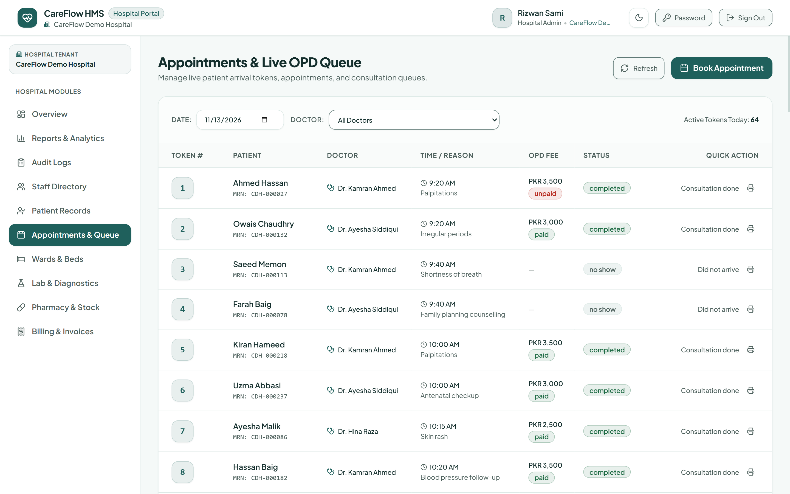
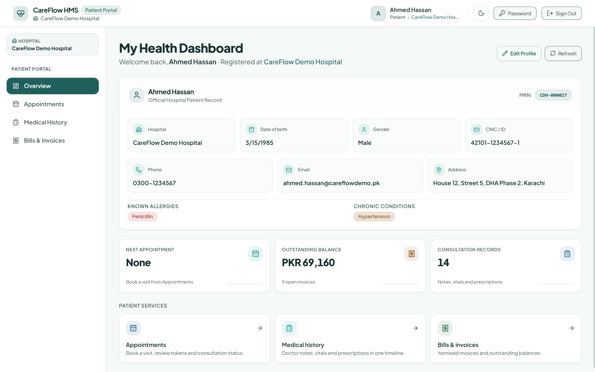
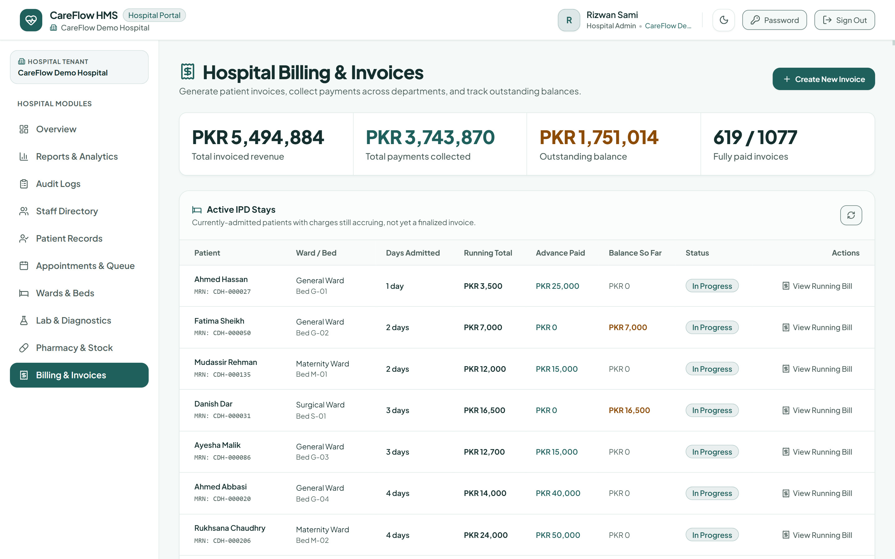

# CareFlow HMS

**A multi-tenant Hospital Management System (SaaS)**: built on the MERN stack to onboard and serve multiple hospitals from a single platform, with strict per-hospital data isolation enforced at the database layer.

**Frontend**


**Backend**


**Tooling and tests**


**Runtime and hosting**


**Live demo:** [hms-project-hhtz.vercel.app](https://hms-project-hhtz.vercel.app)

## Overview

CareFlow HMS is designed for hospitals of any size to manage their day-to-day clinical and administrative operations, from OPD registration and appointment scheduling to IPD admissions, lab diagnostics, pharmacy dispensing, billing, and reporting, all within one system, while allowing the platform owner to onboard and manage 100+ hospitals as independent, fully isolated tenants. A public landing page handles demo requests from prospective hospitals, and each hospital's data (and payments) stay fully isolated from every other tenant.

The repository holds two deployable projects: `hms-backend` (Express API) and `hms-frontend` (React SPA). Nothing runs from the repository root; each folder installs and runs on its own.

## Features

- **Multi-Tenant Architecture:** each hospital's data (patients, staff, appointments, records) is completely isolated at the database query layer, not just hidden in the UI
- **Role-Based Access Control:** 9 distinct roles (Platform Super Admin, Hospital Admin, Doctor, Receptionist, Nurse, Lab Technician, Pharmacist, Accountant, Patient), each with a tailored workspace
- **Public Landing Page & Demo Requests:** a marketing front door where prospective hospitals can request a demo
- **OPD & Appointments:** patient registration with auto-generated MRNs, doctor-wise scheduling, a live token-based queue, patient self check-in from the portal, double-booking prevention enforced at the database level, and automatic no-show detection that frees the slot for rebooking
- **Clinic queue workflow:** priority queue (`normal`/`senior`/`emergency`) with a mandatory, audited reason for any jump; automatic senior suggestion from date of birth that staff must confirm; **walk-in tokens** issued at the front desk with no time slot, even when the doctor has a schedule; per-doctor-per-day token sequences; a "Call next" button that moves the next patient into consultation, with one patient in consultation per doctor enforced by a partial unique index
- **Waiting-room TV display:** a public, login-free screen (per hospital, revocable link) showing one column per doctor with the token being served and the next five tokens only, with no patient names, MRNs or priority labels
- **Digital Pre-Check:** symptoms, vitals and report uploads submitted by the patient from the portal or typed at the front desk, shown to the doctor inside the consultation form
- **Clinical Records:** doctor consultations with vitals, diagnosis, and e-prescriptions; a full patient EMR timeline, including allergies and chronic conditions
- **IPD / Ward Management:** ward and bed setup, live occupancy tracking, admission/discharge workflow, nursing rounds notes
- **Laboratory:** test catalog, order tracking through to results
- **Pharmacy:** batch-level inventory tracking with FEFO (first-expiry-first-out) dispensing, low-stock alerts, and atomic stock deduction
- **Billing & Invoicing:** itemized bills across OPD/IPD/Lab/Pharmacy with payment tracking, insurance/panel/TPA coverage splits, and Pakistan-friendly payment methods (cash, card, JazzCash, EasyPaisa, bank transfer)
- **Reports & Analytics:** financial, clinical, and operational dashboards with charts
- **Data Export:** hospital admins can export their own patients, bills, medicines, or appointments as JSON or CSV at any time, with no lock-in
- **Audit Logging:** every mutating action and every patient-record read is recorded with a readable action name, the affected record's id, the patient whose chart was opened, and a name/role snapshot of the user (so an entry still reads correctly after a rename or deletion). Query strings are never stored. The viewer filters by user, action and date range.
- **Patient Self-Service Portal:** patients sign up, book and cancel their own appointments, check themselves in (when the hospital allows it), submit a pre-check, and view their medical history and bills
- **Hospital Settings:** per-hospital queue behaviour, senior age threshold, average consultation time (which turns "N patients ahead" into a wait estimate) and a regeneratable waiting-room display key
- **Patient-facing legal pages:** Terms and Privacy routes with placeholder sections, linked from the landing footer and the signup form, pending legal review
- **Email Notifications:** low-stock, subscription-trial, and appointment reminder alerts

## Screenshots

_All screenshots show the seeded demo data created by `npm run seed:demo` (CareFlow Demo Hospital), so every queue number, patient and invoice below is reproducible._

<table>
  <tr>
    <td align="center" width="33%"><b>Landing page</b></td>
    <td align="center" width="33%"><b>Login</b></td>
    <td align="center" width="34%"><b>Hospital admin dashboard</b></td>
  </tr>
  <tr>
    <td align="center"></td>
    <td align="center"></td>
    <td align="center"></td>
  </tr>
  <tr>
    <td align="center" width="33%"><b>Appointments queue</b></td>
    <td align="center" width="33%"><b>Walk-in and priority</b></td>
    <td align="center" width="34%"><b>Waiting-room TV display</b></td>
  </tr>
  <tr>
    <td align="center"></td>
    <td align="center"></td>
    <td align="center"></td>
  </tr>
  <tr>
    <td align="center" width="33%"><b>Patient portal</b></td>
    <td align="center" width="33%"><b>Pre-check</b></td>
    <td align="center" width="34%"><b>Billing and invoices</b></td>
  </tr>
  <tr>
    <td align="center"></td>
    <td align="center"></td>
    <td align="center"></td>
  </tr>
  <tr>
    <td align="center" width="33%"><b>Reports</b></td>
    <td align="center" width="33%"><b>Platform super admin</b></td>
    <td align="center" width="34%"><b>Dark mode</b></td>
  </tr>
  <tr>
    <td align="center"></td>
    <td align="center"></td>
    <td align="center"></td>
  </tr>
  <tr>
    <td align="center" width="33%"><b>Phone view (reception)</b></td>
    <td align="center" width="33%"><b>Audit logs</b></td>
    <td align="center" width="34%"><b>Settings page</b></td>
  </tr>
  <tr>
    <td align="center"></td>
    <td align="center"></td>
    <td align="center"></td>
  </tr>
</table>

## Repository layout

```text
hms-backend/
  api/index.js            Vercel entry point (wraps src/app.js)
  server.js               Local entry point (listens on PORT)
  src/app.js              Express app, middleware, route mounting, error handler
  src/config/             env validation, Mongo connection, Cloudinary
  src/controllers/        One per domain, no business logic in routes
  src/jobs/               Trial reminders, appointment reminders
  src/middleware/         auth, rbac, auditLogger, phiAudit, upload
  src/models/             Mongoose schemas, all with the tenant plugin
  src/routes/             Thin routers: middleware chain plus controller
  src/scripts/            Seeders, index sync, auth regression checks
  src/utils/              Tenant context and plugin, queue order, audit actions,
                          billing totals, mailer, PDF helpers, rate limiting
  tests/                  node:test suites and helpers
hms-frontend/
  src/routes/index.jsx    The single route table
  src/pages/              Public pages, hospital shell pages, portal, reports
  src/components/hospital Dense per-module screens (queue, patients, billing, ...)
  src/components/ui/      Button, card, badge, input, modal, skeleton, empty state
  src/layouts/            Staff dashboard shell and patient portal shell
  src/lib/                axios instance, query client, theme helpers, utils
  src/store/              Zustand auth and theme stores
screenshots/              README images
```

## Architecture

### Request lifecycle

1. `validateEnv()` runs once at boot and refuses to start without `MONGO_URI`, `JWT_SECRET` (32+ characters) or `CLIENT_URL`.
2. `helmet` (CSP off, this API never returns HTML) and CORS against the comma-separated `CLIENT_URL` allow-list, with `Content-Disposition` exposed so downloads keep their filenames.
3. A `connectDB()` middleware awaits the Mongoose connection before any handler, which is what makes a cold serverless invocation safe.
4. The route's chain runs: `protect` (decode the token, reload the user, re-check account, hospital and trial state), then `allowRoles(...)`, then an optional `auditLogger` or `auditPhiRead`.
5. The controller works through models only; the tenant plugin injects the hospital scope from the request's `AsyncLocalStorage` context.
6. A JSON 404 for unknown routes and one error handler, which hides internal messages on 5xx in production.

### Tenant isolation

Tenant isolation is enforced automatically at the database layer using an `AsyncLocalStorage`-based request context combined with a Mongoose plugin, so every Mongoose query is scoped to the logged-in user's hospital by construction, not something a developer has to remember to add per-query. Aggregations are the one exception (a pipeline can't be filtered after the fact), so the plugin rejects any aggregate that doesn't start with a `$match` on the current `hospitalId`.

Two escape hatches exist on purpose and are auditable by grepping for them: `.setOptions({ skipTenantScope: true })` for genuinely cross-tenant work (login lookup by email, cron across hospitals, seeding a tenant), and aggregates executed inside `runWithTenantContext(...)`. In strict mode a query with no context throws instead of silently reading across tenants.

### Appointments, tokens and the queue

- A token counter per doctor per day (`opd_token_<doctorId>_<YYYY-MM-DD>`) is incremented atomically, so each room runs its own sequence. A token number is only meaningful with its doctor, and every surface that prints one (slip PDF, reminder email, exports, portal, TV) prints the doctor alongside it. Duplicate-key races are mapped to friendly 409s, and a failed booking releases its token instead of burning it.
- Partial unique indexes prevent double-booking: one booking per doctor and slot time, one active visit per patient+doctor+day, and at most one `in_consultation` patient per doctor per day.
- Walk-ins have no slot time, are created as `checked_in` with a `checkedInAt` timestamp, and share the same per-doctor token sequence.
- The waiting order for checked-in patients is defined in one place, `src/utils/queueOrder.js`: **priority rank (emergency, senior, normal), then check-in time, then token number**. The queue, "Call next", the patient's live status and the TV display all use it, so no two surfaces can disagree about who is next.
- `GET /api/appointments/queue` is read-only. No-show flagging is a write, so it happens on write paths (booking, walk-in, call next) plus a daily cron, never inside a queue read, because a read that writes breaks caching and retries and lets a page load decide clinical state.
- Live polling is scoped to the visible tab: the queue refreshes every 12s and the patient portal every 15s, and both stop while the tab is hidden. The waiting-room TV is the deliberate exception, it is a kiosk and keeps polling.

### Audit trail

- `src/middleware/auditLogger.js` records a mutation on the response's `finish` event, so a failed action is stored with its failure status; `src/middleware/phiAudit.js` records reads of patient data (patient record, EMR, consultation, prescription download, lab history, pre-check) and captures the patient id before Express clears `req.params`.
- `src/utils/auditActions.js` turns a method plus path pattern into a readable action ("Viewed a patient record") and extracts the first ObjectId from the path as the resource id.
- Stored fields: method, path **without** the query string, status code, readable action, resource id, patient id (PHI reads only), user id plus a name and role snapshot, optional human detail ("Priority normal -> senior (Senior citizen, age 74)"). The hospital id is stored explicitly because the request context may already be gone when the response finishes.
- The viewer lists entries by user, action and date range through `userId`, `action`, `from` and `to`; `GET /api/audit-logs/actions` returns the filterable action list.

### Frontend

- **Entry and routing:** `src/routes/index.jsx` is the single route table. Every page is a `React.lazy` chunk inside one `Suspense` with `RouteFallback`, so a visitor never downloads the dashboard or recharts. `ProtectedRoute` sends a signed-in user to their own workspace instead of showing a page their role cannot use.
- **Server state:** TanStack Query. Query keys include the filters that matter (date, doctor, audit filters), `keepPreviousData` keeps tables stable while paging, and `src/lib/queryClient.js` installs a `QueryCache` error toast that ignores 401 and 403 because those already redirect.
- **Client state:** Zustand. `authStore` persists the token and user under `careflow-auth` and exposes `login`, `signupPatient`, `fetchMe` and `logout`; `themeStore` wraps the theme helpers.
- **HTTP:** one axios instance in `src/lib/api.js` attaches the Bearer token. The response interceptor ends the session on 401, redirects to `/change-password` on `PASSWORD_CHANGE_REQUIRED`, and on `ACCOUNT_DISABLED`, `HOSPITAL_SUSPENDED` or `TRIAL_EXPIRED` logs out and carries the server's explanation to the login screen. PDFs and exports are fetched as blobs because a plain link cannot carry the token.
- **Client-side account model:** a hybrid of staff enabling portal access for an existing record and patient self-registration. A self-registration that matches an existing clinical record is never linked automatically; the record's own email must confirm a one-time code first, or the front desk links it after checking ID in person.
- **UI kit and theme:** `src/components/ui` holds the primitives; colours come from Tailwind tokens in `src/index.css` (`bg-card`, `text-foreground`, `border-border`, `primary`, `warning`, `success`), so light and dark stay in sync. `index.html` resolves the theme before first paint, so a dark-mode visitor never sees a light flash.
- **Failure handling:** `ErrorBoundary` wraps the routes and shows a recoverable panel instead of a white screen, the `*` route renders `NotFound`, and each data view has its own loading, empty and error branch with retry.
- **Accessibility and mobile:** every form field has a label tied to its input; modals set `role="dialog"`, `aria-modal`, `aria-labelledby` and `aria-describedby`, focus the first control, trap Tab, close on Escape and return focus to the trigger; icon-only buttons carry `aria-label` and the drawer reports `aria-expanded`. Below `sm` the header drops the user's name and role, moves "Change Password" into the drawer, and dense tables scroll horizontally instead of squashing columns.

### API surface

All backend routes are mounted in `src/app.js` and return JSON unless they stream a file.

| Prefix | What it serves | Route file |
| --- | --- | --- |
| `/api/health` | Liveness, also used by the frontend to warm a cold function | inline in `app.js` |
| `/api/auth` | Login, logout, password reset, change password, session identity | `authRoutes.js` |
| `/api/super-admin` | Hospitals, subscriptions, platform stats, demo leads | `superAdminRoutes.js` |
| `/api/patients` | Patient records, EMR, documents, export | `patientRoutes.js` |
| `/api/appointments` | Booking, queue, check-in, call next, priority, walk-ins, token slip | `appointmentRoutes.js` |
| `/api/doctor-schedules` | Weekly availability per doctor | `doctorScheduleRoutes.js` |
| `/api/hospital-admin` | Staff, settings, hospital profile | `hospitalAdminRoutes.js` |
| `/api/consultations` | Consultations, prescriptions, PDFs | `consultationRoutes.js` |
| `/api/pre-checks` | Patient and desk pre-check submissions | `preCheckRoutes.js` |
| `/api/wards` | Wards, beds, occupancy | `wardRoutes.js` |
| `/api/admissions` | Admission, transfer, discharge | `admissionRoutes.js` |
| `/api/lab` | Tests, orders, results, report files | `labRoutes.js` |
| `/api/pharmacy` | Medicines, batches, sales, stock | `pharmacyRoutes.js` |
| `/api/billing` | Bills, payments, invoices | `billingRoutes.js` |
| `/api/reports` | Financial, clinical and operational reports | `reportsRoutes.js` |
| `/api/audit-logs` | Audit entries and the filterable action list | `auditRoutes.js` |
| `/api/public` | Hospital list, patient signup, demo requests, waiting-room display | `publicRoutes.js` |
| `/api/cron` | Vercel Cron targets: trial check, reminders, no-show sweep | `cronRoutes.js` |

The unauthenticated paths are exactly the `/api/public` ones, where the display key is the credential. Everything else requires a token.

### Frontend routes

| Path | Access | Screen |
| --- | --- | --- |
| `/` | Public | Landing page (signed-in users are redirected to their workspace) |
| `/login`, `/forgot-password`, `/reset-password` | Public | Authentication |
| `/signup` | Public | Patient self-registration |
| `/terms`, `/privacy` | Public | Placeholder legal pages, pending legal review |
| `/display/:hospitalId` | Public | Waiting-room TV display, key in the query string |
| `/change-password` | Any signed-in user | Forced or voluntary password change |
| `/dashboard` | Hospital admin | Overview |
| `/dashboard/patients` | All staff roles | Patient directory and EMR |
| `/dashboard/appointments` | Admin, doctor, receptionist | OPD queue, booking, walk-ins, priority |
| `/dashboard/wards` | Admin, doctor, receptionist, nurse | Wards, beds, admissions |
| `/dashboard/lab` | Admin, doctor, nurse, lab technician | Lab orders and results |
| `/dashboard/pharmacy` | Admin, pharmacist | Inventory and dispensing |
| `/dashboard/billing` | Admin, accountant, receptionist | Bills, payments, invoices |
| `/dashboard/audit-logs` | Hospital admin | Audit viewer with user, action and date filters |
| `/dashboard/settings` | Hospital admin | Hospital profile, queue settings, display key |
| `/dashboard/reports` | Admin, accountant | Reports overview, financial, clinical, operations |
| `/portal` | Patient | Overview |
| `/portal/appointments` | Patient | Booking, cancellation, live queue status |
| `/portal/history` | Patient | Visits, prescriptions, lab results |
| `/portal/bills` | Patient | Invoices |
| `/super-admin/dashboard` | Platform super admin | Hospitals, subscriptions, leads |
| anything else | Public | 404 page with a role-aware home link |

## Getting Started

Node 18 or newer is required. Each side has its own `package.json`; run the backend and frontend in separate terminals.

### 1. Backend

```bash
cd hms-backend
npm install
cp .env.example .env              # fill in every value from the environment table below
npm run seed:superadmin           # creates the one Platform Super Admin account
npm run seed:demo                 # optional: "CareFlow Demo Hospital" with 12 months of sample data
npm run dev                       # http://localhost:5000
```

### 2. Frontend

```bash
cd hms-frontend
npm install
cp .env.example .env              # VITE_API_URL=http://localhost:5000 for local development
npm run dev                       # http://localhost:3000
```

The dev server runs on port 3000 (`vite.config.js`), so the backend's `CLIENT_URL` must include `http://localhost:3000` or the browser blocks the API calls.

## Environment Variables

### Backend (`hms-backend/.env`)

All of these are read via `process.env` somewhere in `src/`. Set every one of them (except where noted "Vercel only" or "local only") in Vercel's dashboard under Project Settings, Environment Variables before deploying.

| Variable | Required | Used for |
| --- | --- | --- |
| `MONGO_URI` | Yes | MongoDB Atlas connection string (free M0 tier is enough). |
| `JWT_SECRET` | Yes | Signs and verifies login tokens. Must be at least 32 characters, or the app refuses to start. |
| `JWT_EXPIRES_IN` | Yes | Token lifetime, e.g. `1d`. |
| `CLIENT_URL` | Yes | Comma-separated list of allowed frontend origins for CORS (e.g. your Vercel frontend URL, plus `http://localhost:3000` for local dev). Required: there is no `*` fallback, and the app refuses to start without it. |
| `SUPER_ADMIN_NAME` | Yes (once) | Used only by `npm run seed:superadmin` to create the one Platform Super Admin account. |
| `SUPER_ADMIN_EMAIL` | Yes (once) | Same as above. |
| `SUPER_ADMIN_PASSWORD` | Yes (once) | Same as above. |
| `CLOUDINARY_CLOUD_NAME` | Yes | Free-tier Cloudinary account, used for any uploaded files/images. |
| `CLOUDINARY_API_KEY` | Yes | Same Cloudinary account. |
| `CLOUDINARY_API_SECRET` | Yes | Same Cloudinary account. |
| `EMAIL_HOST` | Yes | SMTP host for `src/utils/mailer.js` (e.g. Gmail SMTP). |
| `EMAIL_PORT` | Yes | SMTP port (e.g. `587`). |
| `EMAIL_USER` | Yes | SMTP username/login email. |
| `EMAIL_PASS` | Yes | SMTP password or app password. |
| `EMAIL_FROM_NAME` | Yes | Display name used as the "from" on outgoing emails. |
| `LEAD_NOTIFICATION_EMAIL` | Yes | Where "Request a Demo" submissions from the public landing page get emailed. Can be any inbox you check, e.g. your own. |
| `CRON_SECRET` | Yes (on Vercel) | Vercel automatically sends this as a Bearer token to the cron endpoints. Without it set, every cron job returns 401. Not needed locally since cron doesn't run on `npm run dev`. |
| `APP_TIMEZONE` | No | IANA timezone for "today"/working-hours logic, e.g. `Asia/Karachi`. Defaults to `Asia/Karachi` if unset. |
| `PORT` | Local only | Port for `npm run dev` / `node server.js`. Not used on Vercel (serverless, no listening port). |
| `NODE_ENV` | No | Set automatically by Vercel to `production`. |

### Frontend (`hms-frontend/.env`)

| Variable | Required | Used for |
| --- | --- | --- |
| `VITE_API_URL` | Yes | Base URL of the backend API (e.g. `http://localhost:5000` locally, your deployed backend's URL in production). Read in `src/lib/api.js` and `src/store/authStore.js`. |

Vite only exposes vars prefixed `VITE_` to client code (`import.meta.env.VITE_*`), so anything else added to `.env` here is silently invisible to the app, and nothing secret belongs in this file because every `VITE_` value ships to the browser. New backend variables must be added to this table and to `hms-backend/.env.example` together, so the two don't drift apart.

## Scripts

### Backend

| Command | What it does |
| --- | --- |
| `npm run dev` | Starts the API with nodemon on `http://localhost:5000`. |
| `npm start` | Starts the API with plain `node server.js`. |
| `npm test` | Runs the test suite with Node's built-in runner against an in-memory MongoDB. |
| `npm run seed:superadmin` | Creates the single Platform Super Admin account from the `SUPER_ADMIN_*` variables. |
| `npm run seed:demo` | Builds or rebuilds the isolated "CareFlow Demo Hospital" tenant. `-- --dry-run` builds the dataset in memory and prints counts without writing; `-- --force` allows the run when `NODE_ENV=production`. |
| `npm run sync:indexes` | Brings every collection's indexes in line with the schemas, including the `Appointment` partial unique indexes. Needed after an index definition changes, since Mongoose won't replace an existing index with the same keys on its own. |
| `npm run check:auth` | Repeatable auth regression checks (forgot-password delivery path, login lockout, client countdown data). Creates two throwaway Platform Super Admin users over HTTP against the configured database, then deletes them; email credentials are cleared in-process so nothing is sent. |

### Frontend

| Command | What it does |
| --- | --- |
| `npm run dev` | Starts the Vite dev server on `http://localhost:3000`. |
| `npm run build` | Production build into `dist/`, with React pinned to its own long-lived chunk. |
| `npm run preview` | Serves the production build locally. |
| `npm run lint` | Runs oxlint over `src/`. |
| `npm run check:contrast` | Audits every theme colour pair in `src/index.css` against WCAG 2.1 (4.5:1 text, 3:1 UI). |

## Tests

`cd hms-backend && npm test` runs the whole backend suite on Node's built-in test runner (`node --test "tests/*.test.js"`). It boots an in-memory MongoDB through `mongodb-memory-server` and drives the real Express app with `supertest`, so it needs no Atlas connection, no credentials and no network. Two test-only devDependencies (`mongodb-memory-server`, `supertest`) exist for exactly this; nothing else was added.

| File | Covers |
| --- | --- |
| `tenantIsolation.test.js` | Two hospitals side by side: every model rejects reads, writes and aggregates that cross the tenant boundary, including the collection-level escape hatches. |
| `rbacMatrix.test.js` | Role-by-route matrix: every protected route is checked against every role, plus unauthenticated access. |
| `hospitalAccess.test.js` | Suspended hospital and disabled account blocking on an already-issued token. |
| `patientSignup.test.js` | Self-registration, the verification-code link to an existing record, and the refusal to link without the code. |
| `appointmentFlow.test.js` | Appointment state machine, queue ordering (priority, then check-in time, then token) and per-doctor token sequences. |
| `auditTrail.test.js` | Recorded action names, resource ids, PHI-read patient ids, user snapshots, and that query strings never reach the log. |
| `seedDemoData.test.js` | Runs the real demo seeder CLI twice against the memory database: exit code, counts, idempotency, other tenants untouched, walk-in and priority invariants. |

## Demo Data

`npm run seed:demo` builds one standalone tenant, **CareFlow Demo Hospital**, with 12 months of activity for screenshots and sales demos: staff and doctor schedules, 250 patients, ~900 appointments (including today's live OPD queue and the consultations behind it), wards and beds with current and past admissions, bills with paid/partial/unpaid balances, lab orders, pharmacy stock and dispensing, and the audit trail behind the dashboard's recent-activity feed.

The queue and audit data are built to exercise the current features, not just to look full: per-doctor-per-day token sequences, four walk-ins inside today's queue (one emergency, one senior, both with a recorded reason), senior flags raised by date of birth, patient-submitted pre-checks plus one desk-recorded vitals pre-check, and audit entries for PHI reads (patient record, EMR, prescription download, lab history, pre-check) alongside the mutating actions.

Every write is scoped to that hospital's own `hospitalId`. It is idempotent: re-running it wipes and rebuilds only the demo hospital's data. Every date is generated relative to "now", so the data always looks current whenever it is run. `--dry-run` builds and validates the whole dataset in memory without writing, which is the safe way to check a change to the seeder. At the end it prints the counts it created (plus billed/collected/outstanding totals and today's queue) and a login for every role. All demo accounts use the password `CareFlow@123`:

| Role | Email |
| --- | --- |
| Hospital admin | `admin@careflowdemo.pk` |
| Doctor | `kamran.ahmed@careflowdemo.pk` |
| Receptionist | `sadia.imtiaz@careflowdemo.pk` |
| Nurse | `rabia.aslam@careflowdemo.pk` |
| Lab technician | `farhan.ali@careflowdemo.pk` |
| Pharmacist | `mariam.zafar@careflowdemo.pk` |
| Patient portal | `ahmed.hassan@careflowdemo.pk`, `fatima.sheikh@careflowdemo.pk`, `ayesha.malik@careflowdemo.pk` |

The other doctors and staff accounts follow the same `firstname.lastname@careflowdemo.pk` pattern and are printed at the end of the run.

## Security Notes

- Tenant isolation is enforced in the data layer, not in controllers. The one deliberate bypass anywhere in the code base is `.setOptions({ skipTenantScope: true })`; grep for it.
- Passwords are hashed with bcrypt; tokens are signed JWTs with an expiry; repeated failed logins trigger a temporary lockout, and the login response is the same for a wrong password, a locked account and a missing account.
- `helmet` keeps nosniff, HSTS, no-referrer and frameguard; CORS is an explicit allow-list with no wildcard fallback.
- Uploads are checked by file signature, not the declared MIME type, before they reach Cloudinary.
- In production (`NODE_ENV=production`, set automatically by Vercel) the global error handler hides internal `err.message` text on 5xx responses.
- The public waiting-room display is the only login-free data endpoint. Its key is 128 bits of randomness, compared in constant time (both sides are SHA-256 hashed first, so the comparison length never varies); it returns token numbers only, no names, MRNs or priority labels, with a 5-second `Cache-Control` and a per-IP fixed-window rate limit. Regenerating the key in Hospital Settings invalidates every screen using the old link immediately.
- **Audit trail:** writes are logged on response (never on request), so a failed action is recorded as failed; the log stores the path without the query string, the decoded user name and role at the time of the action, the affected resource id, and, for patient-data reads, the patient id.
- The demo seeder is tenant-safe: every write is scoped to the demo hospital's own `hospitalId`, no other hospital is read or modified, and the script aborts rather than reusing an email that already belongs to another tenant.
- Real credentials stay out of the repository: the single root `.gitignore` ignores `.env` and `.env.*` at every depth while keeping `.env.example` tracked, and `.env.example` lists every variable with safe placeholders.
- The Terms and Privacy pages are placeholders with a visible "pending legal review" note. They exist so the footer and signup links resolve; the wording is not legal advice and must be replaced before selling the product.

## Deploying to Vercel

Both projects deploy from the same repository as two separate Vercel projects.

### Backend

1. Import the repo into Vercel and set Root Directory to `hms-backend`.
2. Add every backend variable from the table above in the Vercel dashboard (Project Settings, Environment Variables).
3. Deploy. `vercel.json` routes everything through `api/index.js`, bundles the PDFKit font files, and schedules the cron jobs below, all protected by `CRON_SECRET`.
4. Run `npm run sync:indexes` once against the production database after deploying an index change.

| Cron | Path | Schedule (UTC) |
| --- | --- | --- |
| Trial ending soon | `/api/cron/trial-check` | `0 4 * * *` |
| Appointment reminders | `/api/cron/appointment-reminders` | `0 13 * * *` |
| OPD no-show sweep | `/api/cron/no-show-sweep` | `30 19 * * *` |

### Frontend

1. Import the repo into Vercel and set Root Directory to `hms-frontend` (framework preset: Vite).
2. Add `VITE_API_URL` in the Vercel dashboard, pointing at your deployed `hms-backend` URL.
3. Deploy. `vercel.json` rewrites all routes to `index.html` for client-side routing.

### Hobby Plan Notes

- **Cron jobs:** capped at once a day each (not a job-count limit); all three jobs here are daily. Anything needing finer timing is done as a lazy check on write instead of an extra cron job, which is also why the OPD no-show sweep is forced from the booking, walk-in and call-next paths rather than from a queue read.
- **Function duration:** capped at 300 seconds; nothing here runs anywhere close to that.
- **Response size:** capped at 4.5 MB; the data export endpoint caps record counts per request and flags truncation so it stays under that. The frontend is a static Vite build with no serverless functions, so these limits don't apply to it.

## License

Proprietary, all rights reserved.
